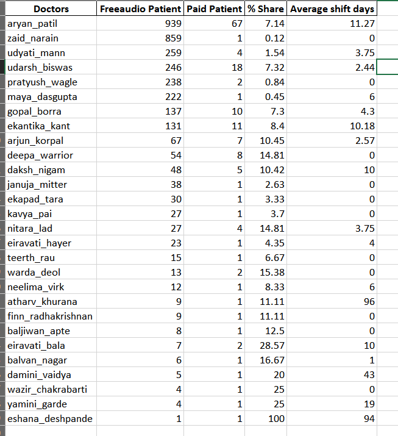
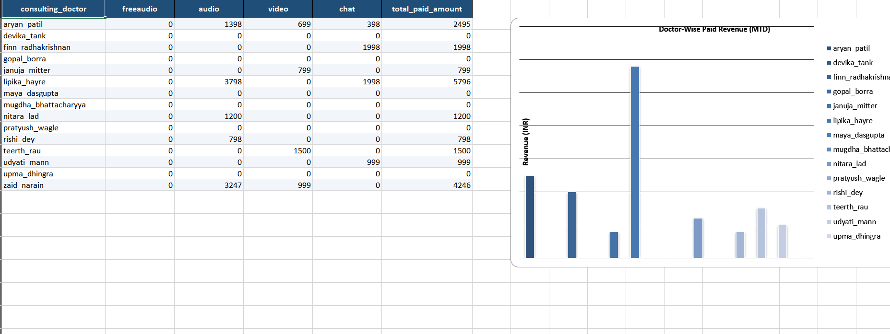
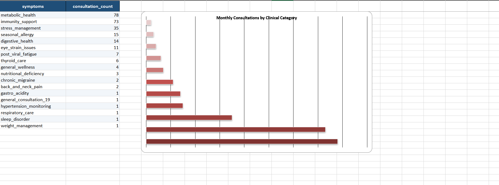
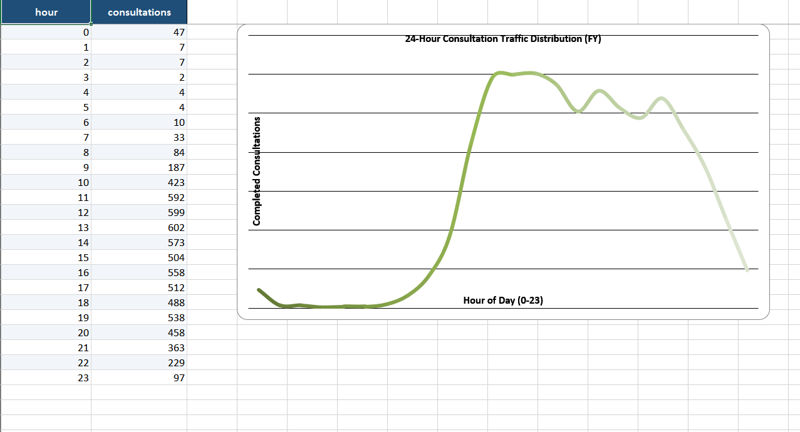

# Telehealth MIS & Funnel Conversion Automation Engine

## 📌 Business Problem & Operational Context
In high-volume telehealth operations, tracking the patient funnel from **Free Audio consultations (`freeaudio`)** to **Paid Consultations (`audio`, `video`, `chat`)** across thousands of booking logs is critical for unit economics and doctor performance evaluation[cite: 7].

Previously, generating weekly and month-to-date (MTD) MIS reports required running complex SQL queries manually and copy-pasting raw outputs into multi-tab Excel workbooks for weekly leadership reviews[cite: 7]. This pipeline automates the entire ETL and reporting workflow in Python—replicating multi-step SQL cohort logic and outputting a 21-tab executive Excel workbook in seconds[cite: 7].

---

## ⚙️ Core Analytical Logic (`consultation.py`)
The pipeline ingests raw booking logs (`appointment.csv`, **9,619 consultation records**) and computes **21 distinct operational and financial views** across three time horizons (**Weekly**, **Month-to-Date (M2D)**, and **Financial Year (FY)**)[cite: 7]:

1. **Free-to-Paid Funnel Attribution (SQL Window Logic in Pandas):**
   * Identifies each patient's **first-ever completed `freeaudio` consultation** (`booked_date` + exact `time_parsed`)[cite: 7].
   * Matches the earliest subsequent completed paid consultation (`audio`, `video`, or `chat`) occurring strictly after the free session (`paid_date > freeaudio_date` or same-day `paid_time > freeaudio_time`)[cite: 7].
   * Computes **Shift Days** (lag time to conversion), **Doctor-wise Conversion Rate (`% Share`)**, and cross-FY cohort spillover (`prev_fy` vs `this_fy`)[cite: 7].
2. **Patient Acquisition & Retention Cohorts:**
   * Tracks first-time platform patients (`new_patients_fy`, `new_patients_week`) vs. returning patient volume (`existing_weekly`)[cite: 7].
   * Isolates repeat users (`more_than_one_fy_m2d`, `more_than_one_week`) while capping multiple `freeaudio` sessions at 1 per patient to prevent artificial retention inflation[cite: 7].
3. **Doctor Utilization, Revenue & No-Show Audits:**
   * Multi-channel pivot tables tracking doctor caseloads (`doctor_weekly`, `doctor_monthly_m2d`) and realized revenue (`revenue_doctor_week`, `revenue_doctor_month_m2d`)[cite: 7].
   * Granular 24-hour distribution matrices (`00:00` to `23:00`) for completed consultations vs. `doctor-no-show` incidents to identify peak operational bottlenecks[cite: 7].
4. **Clinical Category Demand (`symptoms_week` / `symptoms_month`):**
   * De-duplicated symptom demand tracking across patient cohorts[cite: 7].

---

## 📊 Sample Output Tabs & Dashboards (`consultation_metrics_final.xlsx`)

### 1. Doctor-Wise Free-to-Paid Patient Conversion Summary
*(Evaluates doctor-wise freeaudio volume, paid conversions, % conversion share, and average shift days with automated column charts)*


### 2. Patient Shift Attribution (Free-to-Paid Cohorts)
*(Replicates SQL window ranking to track the exact journey of converted patients across consultation tiers)*


### 3. Doctor-Wise Paid Consultation Revenue (MTD)
*(Tracks realized revenue distribution across audio, video, and chat formats per practitioner)*


### 4. Consultations by Clinical Category (Symptoms Breakdown)
*(Aggregates patient demand volume across clinical symptoms with an auto-generated horizontal bar chart)*


### 5. 24-Hour Consultation Traffic Distribution
*(Hourly trend distribution identifying operational peak traffic and platform load between 00:00 and 23:00)*


---

## 🗂️ Repository Structure
```text
├── appointment.csv                        # Anonymized dataset (9,619 booking records)
├── consultation.py                        # End-to-end ETL & multi-sheet Excel generator
├── exports/
│   └── consultation_metrics_final.xlsx    # Automated 21-sheet MIS output workbook
├── assets/                                # Executive screenshots & embedded charts
└── README.md                              # Pipeline documentation